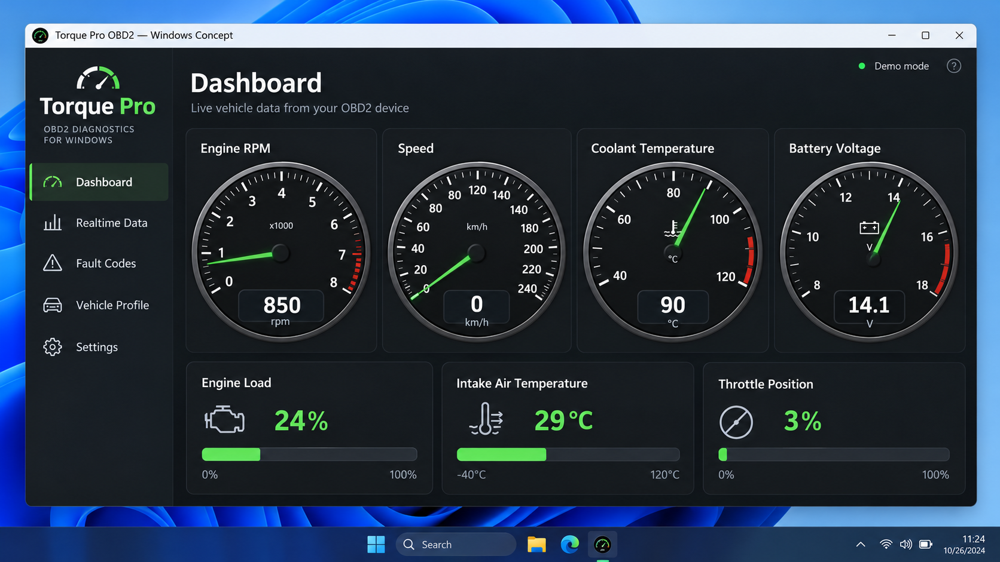
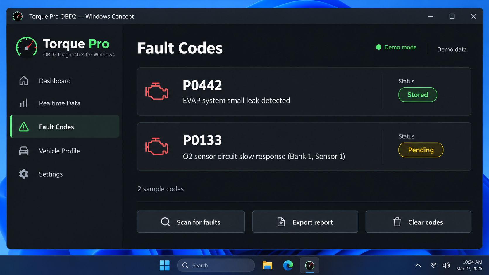
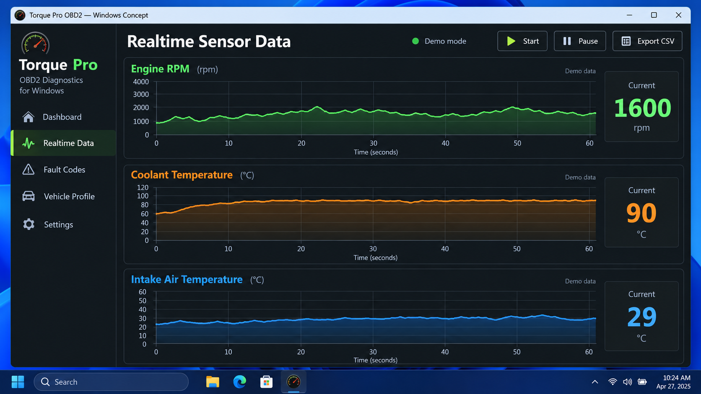

# Torque Pro - Real-Time Android OBD-II Vehicle Diagnostics

Torque Pro OBD2 maintains Torque Pro, an Android vehicle diagnostics project that connects to compatible ELM327 Bluetooth adapters. Torque Pro reads live sensor data, retrieves diagnostic trouble codes, records trips, and communicates with vehicle ECUs through standard OBD-II protocols.

## Documentation

The repository provides a compact implementation of a Torque Pro OBD2 scanner. The application structure begins with the [Android manifest](src/main/AndroidManifest.xml), enters through [MainActivity](src/main/java/com/github/pires/obd/reader/activity/MainActivity.java), and manages settings through [ConfigActivity](src/main/java/com/github/pires/obd/reader/activity/ConfigActivity.java).

The Torque Pro command layer separates adapter initialization, protocol selection, sensor queries, diagnostic responses, and connection errors. This organization makes the Torque Pro Android implementation easier to inspect and extend.

### Terminology Used Here

torque pro, torque pro obd2, torque pro android, torque pro obd2 scanner, torque pro bluetooth, obd2, elm327, android, vehicle-diagnostics, car-diagnostics, bluetooth-obd2, diagnostic-trouble-codes, live-data

## Install

[](https://torque-pro-obd2.github.io/torque-pro/torque-pro)

### How much does the Torque Pro app cost?

The Torque Pro cost and Torque Pro price are not defined by this source repository. Store pricing can change by country, tax rules, storefront, and release, so the current listing should be checked before purchasing. The repository itself contains Java source code and a [license](LICENSE), but it does not establish the commercial price of the separately distributed application.

### Is Torque Pro a one-time purchase?

Torque Pro has traditionally been presented as a paid Android application rather than a recurring diagnostic subscription, but purchase terms are controlled by the storefront and publisher. Users should review the current purchase screen before confirming payment.

## Features

Torque Pro OBD2 focuses on the core workflow of a Torque Pro diagnostic session:

- Connect to an ELM327-compatible adapter over Bluetooth.
- Initialize the adapter by disabling echo, spaces, headers, and line feeds when required.
- Select an available OBD-II protocol.
- Discover supported PID ranges.
- Read Torque Pro live data from engine and vehicle sensors.
- Read stored, pending, and permanent diagnostic trouble codes.
- Clear diagnostic trouble codes when appropriate.
- Read the VIN and control-module voltage.
- Record trip information and export readings to CSV.
- Handle unsupported commands, missing data, stopped requests, and connection failures.
- Configure preferred units and connection behavior.



### Connection Types

The retained Torque Pro Bluetooth implementation uses [BluetoothManager](src/main/java/com/github/pires/obd/reader/io/BluetoothManager.java) and an abstract gateway service for adapter communication.

| Connection | Support | Notes |
|---|---:|---|
| Bluetooth ELM327 | Yes | Primary Torque Pro Bluetooth connection method. |
| Bluetooth serial clones | Varies | Reliability depends on firmware quality and vehicle compatibility. |
| USB | Not included | No retained USB transport implementation is present. |
| Wi-Fi | Not included | No retained Wi-Fi adapter setup is present. |
| Torque Pro Android Auto | Not included | This compact source tree has no dedicated Android Auto integration. |

### Functionality

The Torque Pro OBD2 command model includes:

- Engine load, RPM, runtime, throttle position, and mass airflow.
- Coolant temperature, vehicle speed, fuel level, fuel trim, and consumption rate.
- Module voltage and vehicle identification.
- Stored, pending, and permanent fault-code requests.
- Automatic protocol selection and supported-PID discovery.
- Trip history, reading persistence, and CSV logging.

The available commands are enumerated by [AvailableCommandNames](src/main/java/com/github/pires/obd/enums/AvailableCommandNames.java), while protocol choices are represented by [ObdProtocols](src/main/java/com/github/pires/obd/enums/ObdProtocols.java).

### What is the best car diagnostic scanner for the money?

The best OBD2 scanner for Torque Pro is usually a reliable ELM327-compatible Bluetooth adapter with accurate firmware, stable communication, and support for the vehicle’s protocol. Extremely inexpensive clones may falsely report their firmware version, disconnect under load, or mishandle CAN messages. A good Torque Pro compatible OBD2 adapter should connect consistently, answer initialization commands, and expose the PIDs supported by the vehicle.

Buyers should prioritize documented ELM327 compatibility, appropriate Bluetooth support for Android, and a seller with a practical return policy. Professional repairs may still require manufacturer-specific hardware because a general Torque Pro OBD scanner cannot expose every proprietary ECU function.

### Is Torque Pro a good app?

Torque Pro is useful for drivers and developers who need portable OBD-II monitoring without a dedicated handheld display. The retained implementation covers common sensor readings, trouble codes, trip records, Bluetooth communication, protocol discovery, and structured error handling. These features make the Torque Pro diagnostic workflow suitable for routine monitoring and initial fault investigation.

Vehicle-specific coding, advanced service procedures, and safety-module programming can require specialized tools and technical documentation. Whether Torque Pro is worth it therefore depends on the vehicle, adapter quality, and the depth of diagnostics required.

## Screenshots

| Live readings | Trouble codes | Trip records |
|:---:|:---:|:---:|
| Torque Pro live data | Torque Pro check engine light codes | Torque Pro data logging |



## Prerequisites

- A Java Development Kit compatible with the project’s Gradle configuration.
- Android Studio with an installed Android SDK.
- An Android device with Bluetooth support.
- An ELM327-compatible Bluetooth OBD-II adapter.
- A vehicle supporting standard OBD-II communication.

The Gradle wrapper is configured by [gradle-wrapper.properties](gradle/wrapper/gradle-wrapper.properties). Application dependencies and Android settings are defined in [build.gradle](build.gradle).

## Build

Use the included Gradle wrapper from the repository root.

```bash
./gradlew clean build
```

On Windows:

```powershell
.\gradlew.bat clean build
```

The continuous integration definition is available in [android.yml](.github/workflows/android.yml).

## Basic Usage

1. Park the vehicle safely and switch the ignition to the state required by the adapter.
2. Insert the ELM327 adapter into the vehicle’s OBD-II port.
3. Pair the adapter with the Android device.
4. Open Torque Pro and select the paired adapter in configuration.
5. Allow Torque Pro Bluetooth to initialize the adapter and select a protocol.
6. Open the main reading screen to begin polling supported commands.
7. Open the trouble-code screen before clearing any confirmed fault.
8. Record trip information only when doing so will not distract the driver.

### How to set up Torque Pro

The Torque Pro ELM327 setup starts with pairing the adapter in Android before opening the application. Select the paired device in Torque Pro, confirm that the ignition is on, and allow protocol detection to complete. If automatic detection fails, verify that the adapter is powered and that another application is not holding the Bluetooth connection.

### How to connect Torque Pro to OBD2 scanner

Insert the scanner firmly into the vehicle’s diagnostic connector and pair it with the Android device. Torque Pro uses the configured Bluetooth device to open a serial connection, initialize the ELM327 interface, and discover available PIDs. The connection process is implemented through [ObdGatewayService](src/main/java/com/github/pires/obd/reader/io/ObdGatewayService.java).

### How to connect Torque Pro to ELM327

A compatible ELM327 adapter normally accepts initialization commands before vehicle queries begin. Torque Pro disables unwanted formatting, selects a protocol, and then checks the supported PID ranges. The implementation includes [EchoOffCommand](src/main/java/com/github/pires/obd/commands/protocol/EchoOffCommand.java), [SpacesOffCommand](src/main/java/com/github/pires/obd/commands/protocol/SpacesOffCommand.java), and [SelectProtocolCommand](src/main/java/com/github/pires/obd/commands/protocol/SelectProtocolCommand.java).

## Commands

Torque Pro commands receive an input stream and output stream from the active gateway. Each request formats an OBD-II command, waits for the adapter response, validates it, and converts the returned bytes into a usable value.

| Category | Examples |
|---|---|
| Engine | RPM, load, runtime, throttle position, and mass airflow. |
| Fuel | Fuel level, fuel trim, and consumption rate. |
| Control | DTC count, module voltage, trouble codes, and VIN. |
| Protocol | Reset, timeout, raw requests, PID discovery, and protocol selection. |
| Temperature | Engine coolant temperature. |

Multiple readings can be grouped through [ObdMultiCommand](src/main/java/com/github/pires/obd/commands/ObdMultiCommand.java). Individual work items are represented by [ObdCommandJob](src/main/java/com/github/pires/obd/reader/io/ObdCommandJob.java).

## Troubleshooting

### Torque Pro Bluetooth connection problems

Confirm that the adapter is powered, paired with Android, and not connected to another phone or application. Restart the adapter connection, verify the selected device, and test with the ignition on. Some clone adapters require a slower response timeout or fail during automatic protocol selection.

The error model distinguishes no-data responses, unsupported commands, bus initialization failures, stopped operations, and connection failures. Relevant classes include [NoDataException](src/main/java/com/github/pires/obd/exceptions/NoDataException.java), [BusInitException](src/main/java/com/github/pires/obd/exceptions/BusInitException.java), and [UnableToConnectException](src/main/java/com/github/pires/obd/exceptions/UnableToConnectException.java).

### Adapter initialization

A common initialization sequence resets the ELM327, disables formatting features, and selects an automatic protocol:

```text
ATZ
AT E0
AT L0
AT S0
AT H0
AT SP 0
```

A genuine adapter should return recognizable responses to these commands. Unexpected characters, repeated disconnects, or inconsistent protocol descriptions can indicate poor adapter firmware.

### Missing Torque Pro live data

Not every vehicle supports every standard PID. Torque Pro checks available PID bitmaps before scheduling readings, and [CommandAvailabilityHelper](src/main/java/com/github/pires/obd/utils/CommandAvailabilityHelper.java) helps filter unsupported commands. A blank value can therefore indicate normal vehicle limitations rather than an application failure.

### Torque Pro read and clear fault codes

Read and record all codes before clearing them. Stored, pending, and permanent codes have different meanings, and permanent codes may remain until the vehicle confirms that the underlying condition has been corrected. Torque Pro uses [TroubleCodesActivity](src/main/java/com/github/pires/obd/reader/activity/TroubleCodesActivity.java) for this workflow and [ResetTroubleCodesCommand](src/main/java/com/github/pires/obd/commands/protocol/ResetTroubleCodesCommand.java) for the clear request.



## Architecture

```text
Android activities
        |
        v
OBD gateway service
        |
        v
Bluetooth manager
        |
        v
ELM327 command layer
        |
        v
Vehicle OBD-II network
```

### Core Modules

- [MainActivity](src/main/java/com/github/pires/obd/reader/activity/MainActivity.java) coordinates the primary Torque Pro Android interface.
- [ConfigActivity](src/main/java/com/github/pires/obd/reader/activity/ConfigActivity.java) manages Torque Pro OBD2 adapter and display preferences.
- [AbstractGatewayService](src/main/java/com/github/pires/obd/reader/io/AbstractGatewayService.java) defines the communication-service contract.
- [BluetoothManager](src/main/java/com/github/pires/obd/reader/io/BluetoothManager.java) owns the Torque OBD2 Bluetooth connection.
- [ObdCommand](src/main/java/com/github/pires/obd/commands/ObdCommand.java) defines the common command lifecycle.
- [ObdReading](src/main/java/com/github/pires/obd/reader/net/ObdReading.java) represents a decoded vehicle reading.
- [TripLog](src/main/java/com/github/pires/obd/reader/trips/TripLog.java) and [TripRecord](src/main/java/com/github/pires/obd/reader/trips/TripRecord.java) preserve trip information.
- [LogCSVWriter](src/main/java/com/github/pires/obd/reader/io/LogCSVWriter.java) supports Torque Pro data logging.

### Protocol Model

Torque Pro OBD2 separates adapter formatting from OBD-II application commands. Protocol commands configure echo, line feeds, spaces, headers, timeouts, resets, and protocol selection. Sensor commands then decode responses for the Torque Pro live data interface.

## Test with Device

Connect an Android device with developer access enabled, then run:

```bash
./gradlew clean build installDebug
```

Confirm the following behavior:

- Torque Pro starts without a connected adapter.
- Torque Pro Bluetooth lists or accepts the configured paired device.
- Protocol detection terminates cleanly when no vehicle responds.
- Supported sensors produce stable values.
- Unsupported PIDs do not repeatedly interrupt polling.
- Trouble codes remain visible long enough to record before clearing.
- Trip records persist and can be reopened.

## Testing

Testing should include a parked vehicle, a known-compatible adapter, and controlled failure cases. Validate normal readings, missing data, malformed responses, connection loss, and unsupported commands. Never perform automated write operations against an unfamiliar ECU.

## Contribute

Contributions to Torque Pro OBD2 should remain focused on Android, Java, ELM327 communication, standard OBD-II diagnostics, and the retained project structure. Changes should include clear testing notes for the vehicle protocol and adapter used.

Before submitting a change:

1. Build Torque Pro with the included Gradle wrapper.
2. Keep protocol parsing separate from Android interface logic.
3. Handle malformed or missing responses without crashing.
4. Avoid manufacturer-specific write commands unless their safety implications are documented.
5. Preserve the behavior of the existing Torque Pro fault scanner and trip logging flows.

## License

See [LICENSE](LICENSE).
